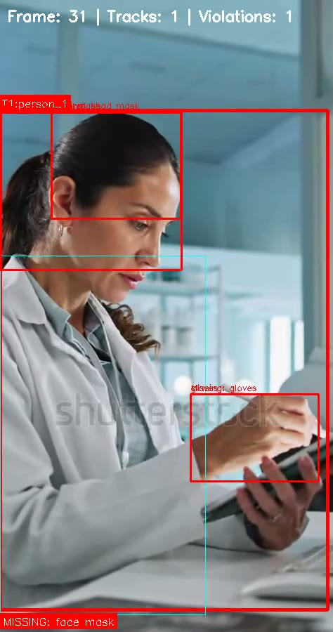
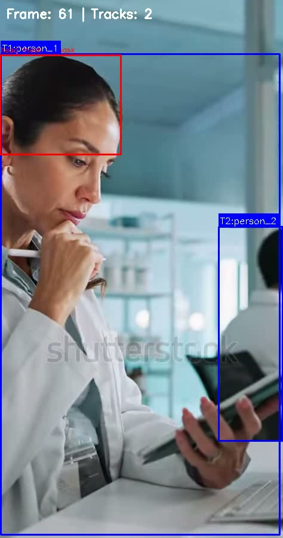
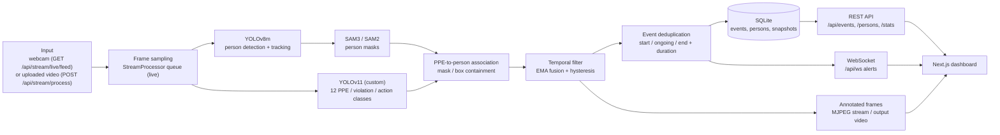
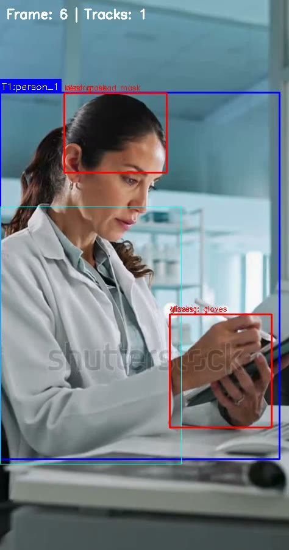

# SentinelVision: Real-Time PPE Compliance Monitoring

   

Real-time PPE compliance monitoring for laboratories and industrial spaces. SentinelVision is an event-driven video processing system that turns noisy, frame-level PPE detections into stable violation events (start / end / duration / evidence snapshot) under real-world constraints like occlusion, limited compute, and long-running streams.

**Docs:** [the-harsh-vardhan.github.io/PPE-Safety-Compliance-Detection-System](https://the-harsh-vardhan.github.io/PPE-Safety-Compliance-Detection-System/) | **Frontend demo mode (sample data, no backend):** [lab-safety-monitor.vercel.app](https://lab-safety-monitor.vercel.app/dashboard)

<p align="center">
  
  
</p>

## What it does

- Detects and tracks people in a webcam feed or uploaded video (YOLOv8m with native tracking).
- Detects PPE items, "no PPE" violation classes and eating/drinking actions with a custom YOLOv11 model (12 classes).
- Associates PPE with each person using segmentation masks (SAM3, with SAM2 fallback) and spatial containment.
- Filters per-frame noise with EMA confidence fusion and hysteresis, then stores deduplicated violation events with start frame, end frame, duration and a snapshot.
- Serves a Next.js dashboard with a live MJPEG monitor, an events log, persons view, statistics and WebSocket violation alerts.

## Architecture



The detector is selected by `DETECTOR_TYPE` (default `hybrid`: YOLOv8 + SAM3/SAM2 + YOLOv11; `yolov11` and `sam3` are also available). More detail in [docs/architecture.md](docs/architecture.md).

## Results

No evaluation metrics (mAP, precision/recall) are published in this repository. The custom YOLOv11 PPE weights and their training data are not included, see [#7](https://github.com/The-Harsh-Vardhan/PPE-Safety-Compliance-Detection-System/issues/7).

## Screenshots

Frames taken from the annotated demo video shipped in `frontend/public/demo/` (pipeline output; the clip carries its stock-footage watermark).

| Tracking | Violation event | Two tracked persons |
| --- | --- | --- |
|  |  |  |

## Problem

Safety enforcement in labs and industrial spaces breaks down when monitoring is manual, inconsistent, or reduced to frame-by-frame alerts.

Common failure modes:
- Manual monitoring does not scale and varies by operator
- Conventional CCTV has no notion of PPE compliance
- Per-frame PPE demos create alert spam under occlusion and partial visibility

---

## Constraints

This project assumes:
- Real-time video input (webcam + recorded footage)
- Limited processing budget (cannot run heavy models on every frame)
- Frequent occlusion (hands, motion blur, partial visibility)
- Multiple people in frame
- Low tolerance for false alerts

---

## Pipeline overview

Pipeline (high level):
1. Video stream (live or file)
2. Person detection + tracking
3. Segmentation for person masks (used for PPE-to-person association)
4. PPE/violation detection
5. Temporal filtering across frames
6. Event creation + duration tracking
7. Dashboard updates (stream + events)

When a violation is detected, the system treats it as an event state that can start, continue, and end, rather than a one-off prediction. This shifts the system from frame-level prediction to a stateful, event-driven model.


---

## Key design choices

Hybrid detection pipeline (lower association errors):
- YOLOv8 for person detection + tracking
- SAM3 for person masks
- YOLOv11 for PPE items and violation classes
- Cost: more moving parts and more compute than a single model

Temporal filtering (reduce alert spam):
- EMA confidence fusion across frames
- Hysteresis thresholds for starting/stopping violations
- Subset matching during short occlusions
- Cost: alerts can be delayed by a few frames

Streaming (predictable latency):
- Display FPS and ML processing FPS are decoupled
- Frames can be cached and dropped to keep processing stable under load
- Cost: some frames are not processed

Event-centric storage (audit-friendly output):
- Start frame, end frame, duration, evidence snapshot
- Person identity is the tracker ID (`person_<track_id>`)

---

## Limitations

- A face-embedding module (InsightFace) and a DeepSORT tracker exist in `backend/app/ml/` but are not wired into the runtime pipeline; identities are YOLOv8 track IDs ([#6](https://github.com/The-Harsh-Vardhan/PPE-Safety-Compliance-Detection-System/issues/6))
- Face recognition would degrade under heavy occlusion or low resolution
- Multi-scale PPE detection increases GPU memory usage
- SQLite is used for local-first development and is not intended for horizontal scaling

---

## What this demonstrates

- Designing an ML pipeline around operational constraints (not best-case inputs)
- Reasoning about trade-offs: accuracy vs latency vs reliability
- Running long-lived video processing with backpressure (drop/caching) instead of building a one-off demo
- Shipping an end-to-end loop (stream -> detection -> event storage -> UI)

---

## Tech stack

- Backend: FastAPI (async), SQLAlchemy + aiosqlite
- Frontend: Next.js 16, React 19, Tailwind CSS, TanStack Query, Recharts
- ML: YOLOv8m (ultralytics, person tracking), custom YOLOv11 PPE detector, SAM3 / SAM2 segmentation, InsightFace (face embeddings, not wired into the pipeline)
- Storage: SQLite (async)
- Streaming: MJPEG + WebSockets

## Quick start

```bash
git clone https://github.com/The-Harsh-Vardhan/PPE-Safety-Compliance-Detection-System.git
cd PPE-Safety-Compliance-Detection-System
```

Prerequisites: Python 3.11+, Node.js 18+ (pnpm), `uv` (CUDA GPU recommended).

Backend (FastAPI):

```bash
cd backend
uv sync
cp .env.example .env
uv run uvicorn app.main:app --reload --host 0.0.0.0 --port 8000
```

Frontend (Next.js):

```bash
cd frontend
pnpm install
pnpm dev
```

URLs:
- UI: http://localhost:3000
- API docs: http://localhost:8000/docs

Model weights (not in the repo):
- SAM3: `backend/weights/sam3/sam3.pt`
- YOLOv11 PPE: `backend/weights/ppe_detector/best.pt`
- If you don't have SAM3 weights, disable SAM3 via env or download weights before running.

## Usage

The API is easiest to explore via `http://localhost:8000/docs`. Examples:

### Process a video file

```bash
curl -X POST http://localhost:8000/api/stream/upload \
  -F "file=@lab_demo.mp4"

curl -X POST http://localhost:8000/api/stream/process \
  -H "Content-Type: application/json" \
  -d '{"video_path": "lab_demo.mp4", "save_output": true}'
```

Poll `GET /api/stream/jobs/{job_id}` for progress and fetch the annotated video from `GET /api/stream/processed/{job_id}`.

### Live monitoring

The live monitor is an MJPEG stream from the default webcam (index 0), annotated in real time. Open it in a browser or an `` tag:

```
http://localhost:8000/api/stream/live/feed
```

Violation alerts are pushed over the WebSocket at `ws://localhost:8000/api/ws`.

## Project structure

```
backend/app/
  api/routes/   REST + stream + WebSocket endpoints
  ml/           detectors, SAM segmenters, temporal filter, stream processor
  services/     persistence, event deduplication, person service
  core/         config, database, WebSocket manager
frontend/src/
  app/          pages (dashboard, monitor, events, persons, settings)
  components/   UI components
  lib/          API client, demo data
docs/           GitHub Pages site and image assets
data/           videos, processed outputs, snapshots (git-ignored)
```

## Configuration

Copy `backend/.env.example` to `backend/.env`, then adjust the relevant settings:

- `REQUIRED_PPE`
- `DETECTION_CONFIDENCE_THRESHOLD`, `VIOLATION_CONFIDENCE_THRESHOLD`
- `TEMPORAL_FUSION_STRATEGY`, `TEMPORAL_EMA_ALPHA`, `TEMPORAL_*_MIN_FRAMES*`
- `LIVE_STREAM_DISPLAY_FPS`, `LIVE_STREAM_PROCESS_FPS`, `LIVE_STREAM_QUEUE_SIZE`
- `MULTI_SCALE_ENABLED`, `MULTI_SCALE_FACTORS`
- `USE_SAM3`, `USE_SAM2`
- `DATABASE_URL`
- `ENABLE_SNAPSHOT_CAPTURE`, `SNAPSHOTS_DIR`

## API

OpenAPI docs are available at `http://localhost:8000/docs` when the backend is running.

## ML models

### Custom YOLOv11 PPE detector

Trained on a lab safety dataset with 12 detection classes:

- PPE items: `goggles`, `mask`, `lab_coat`, `gloves`, `head_mask`
- Violations: `no_goggles`, `no_mask`, `no_lab_coat`, `no_gloves`, `no_head_mask`
- Actions: `drinking`, `eating`

### Pre-trained models

- YOLOv8-medium (person detection + tracking)
- SAM3 (segmentation), SAM2 fallback
- InsightFace (ArcFace) for face embeddings (module present, not used by the pipeline)

## Troubleshooting

### CUDA Out of Memory

- Symptoms: `RuntimeError: CUDA out of memory`

- Fixes:
```bash
# Option 1: Force CPU mode
CUDA_VISIBLE_DEVICES="" uv run uvicorn app.main:app --reload

# Option 2: Reduce processing scale
# In .env: MULTI_SCALE_FACTORS=[1.0]

# Option 3: Lower processing FPS
# In .env: LIVE_STREAM_PROCESS_FPS=1
```

### No Violations Detected

- Symptoms: dashboard shows 0 violations despite visible missing PPE

- Fixes:
1. Lower confidence threshold in `.env`:
   ```env
   VIOLATION_CONFIDENCE_THRESHOLD=0.2  # Default: 0.3
   ```

2. Enable multi-scale detection for small objects:
   ```env
   MULTI_SCALE_ENABLED=true
   ```

3. Verify the YOLOv11 model is loaded correctly:
   - Check logs for `Loaded YOLOv11 PPE detector`
   - Ensure `weights/ppe_detector/best.pt` exists

4. Check required PPE configuration:
   ```env
   REQUIRED_PPE=["safety goggles", "face mask", "lab coat"]
   ```

### Live Stream Lag / Stuttering

- Symptoms: live feed freezes or has significant delay

- Fixes:
1. Reduce processing FPS (default: 3):
   ```env
   LIVE_STREAM_PROCESS_FPS=2  # Or even 1
   ```

2. Decrease queue size (default: 2):
   ```env
   LIVE_STREAM_QUEUE_SIZE=1
   ```

3. Verify GPU utilization:
   ```bash
   nvidia-smi
   ```

4. Disable multi-scale detection for faster processing:
   ```env
   MULTI_SCALE_ENABLED=false
   ```

### Frontend Not Connecting to Backend

- Symptoms: dashboard shows “Connection Error” or empty data

- Fixes:
1. Verify backend is running:
   ```bash
   curl http://localhost:8000/docs  # Should return Swagger UI
   ```

2. Check CORS configuration in `backend/app/main.py`:
   ```python
   allow_origins=["http://localhost:3000"]
   ```

3. Update API URL in `frontend/.env.local`:
   ```env
   NEXT_PUBLIC_API_URL=http://localhost:8000
   ```

---

## Acknowledgments

- YOLOv8/v11: Ultralytics ([https://github.com/ultralytics/ultralytics](https://github.com/ultralytics/ultralytics))
- SAM3: Meta AI ([https://github.com/facebookresearch/sam2](https://github.com/facebookresearch/sam2))
- InsightFace: DeepInsight ([https://github.com/deepinsight/insightface](https://github.com/deepinsight/insightface))
- FastAPI: Sebastián Ramírez ([https://fastapi.tiangolo.com](https://fastapi.tiangolo.com))
- Next.js: Vercel ([https://nextjs.org](https://nextjs.org))

Also developed at [garg-tejas/lab-safety-monitor](https://github.com/garg-tejas/lab-safety-monitor) (merged contributions from that repository).

No LICENSE file is present in the repository.
