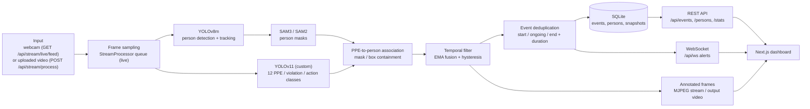

# Architecture

## Runtime pipeline

This page is plain Jekyll, which does not render Mermaid; the diagram renders natively in the [repository README](https://github.com/The-Harsh-Vardhan/PPE-Safety-Compliance-Detection-System#architecture). In words: frames from a webcam or uploaded video are sampled, passed to YOLOv8m for person tracking (then SAM3/SAM2 masks) and, in parallel, to a custom YOLOv11 PPE detector. PPE boxes are associated with persons by containment, the result goes through a temporal filter and then a deduplication step that opens, extends and closes violation events. Events are stored in SQLite and broadcast over a WebSocket; annotated frames are streamed as MJPEG or written to an output video; the Next.js dashboard consumes all three.

## Components

| Area | Location | Notes |
| --- | --- | --- |
| Pipeline | `backend/app/ml/pipeline.py` | `DetectionPipeline.process_frame`: detect, associate, temporal filter, build events, annotate |
| Detector selection | `backend/app/ml/detector_factory.py` | `DETECTOR_TYPE`: `hybrid` (default), `yolov11`, `sam3`, or mock |
| Person tracking | `backend/app/ml/person_detector.py` | YOLOv8m `model.track(persist=True)`, person class only |
| PPE detection | `backend/app/ml/yolov11_detector.py` | Maps 12 classes to PPE items, violation classes (`No Mask`, ...) and actions (`Drinking`, `Eating`) |
| Segmentation | `backend/app/ml/sam3_segmenter.py`, `sam2_segmenter.py` | SAM3 first; falls back to SAM2 if SAM3 fails to initialise |
| Temporal filter | `backend/app/ml/temporal_filter.py` | EMA / mean / max confidence fusion, minimum frames to start and to clear a violation |
| Live streaming | `backend/app/ml/stream_processor.py` | Worker thread and bounded queue decouple display FPS (default 30) from ML FPS (default 3) |
| Deduplication | `backend/app/services/deduplication.py` | Tracks ongoing violations per video source and closes them with end frame and duration |
| Persistence | `backend/app/services/persistence.py` | Writes events and persons, saves snapshots, broadcasts WebSocket alerts |
| API | `backend/app/api/routes/` | `events`, `persons`, `stats`, `stream`, `websocket` |
| Dashboard | `frontend/src/app/` | dashboard, live monitor, events log, persons, settings; demo mode with sample data when the backend is unreachable |

## Design trade-offs

- **Hybrid detection**: fewer person/PPE association errors, at the cost of more models and more compute than a single detector.
- **Temporal filtering**: less alert spam under occlusion, at the cost of alerts delayed by a few frames.
- **Decoupled display and processing FPS**: predictable latency on live streams, at the cost of some frames never being processed.
- **SQLite**: local-first and simple; not intended for horizontal scaling.

## Known gaps

`backend/app/ml/face_recognition.py` (InsightFace) and `backend/app/ml/tracker.py` (DeepSORT) exist but are not wired into the runtime pipeline; person identity is the YOLOv8 track ID.
