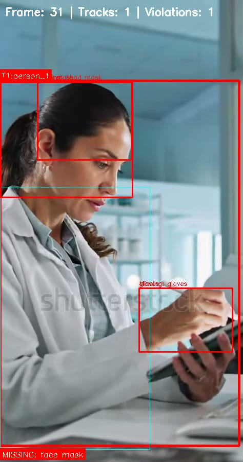
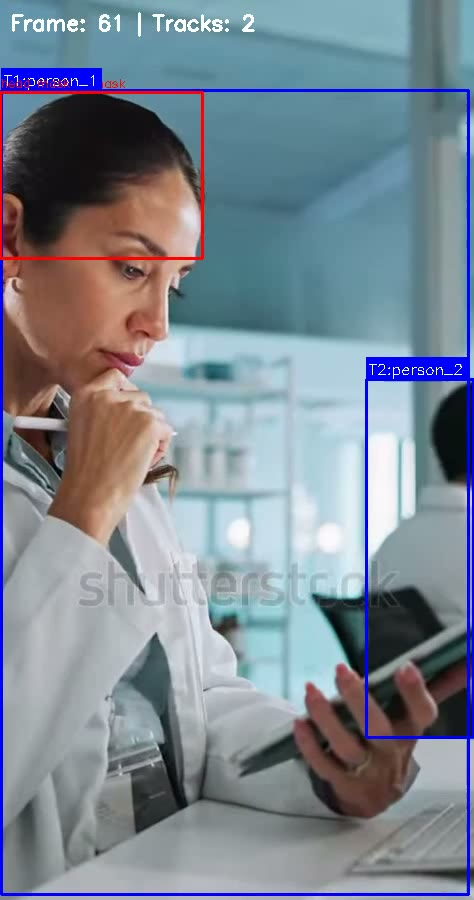

# SentinelVision

Real-time PPE compliance monitoring for laboratories and industrial spaces. It turns noisy, frame-level PPE detections into stable violation events (start, end, duration, evidence snapshot) that survive occlusion, limited compute and long-running streams.

## What it does

- Tracks people in a webcam feed or uploaded video with YOLOv8m.
- Detects PPE, "no PPE" violations and eating/drinking with a custom YOLOv11 model (12 classes).
- Associates PPE with each person using SAM3 (SAM2 fallback) masks.
- Smooths detections with EMA confidence fusion and hysteresis, then stores deduplicated events in SQLite.
- Serves a Next.js dashboard with a live MJPEG monitor, events log and WebSocket alerts.

## Pages

- [Architecture](architecture): the runtime pipeline and component notes
- [Setup](setup): install, configure and run the backend and frontend

## Links

- [Source repository](https://github.com/The-Harsh-Vardhan/PPE-Safety-Compliance-Detection-System)
- [Frontend demo mode (sample data, no backend)](https://lab-safety-monitor.vercel.app/dashboard)

No evaluation metrics are published for the custom PPE model; the weights and training data are not part of the repository.
